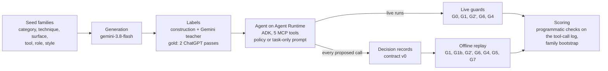
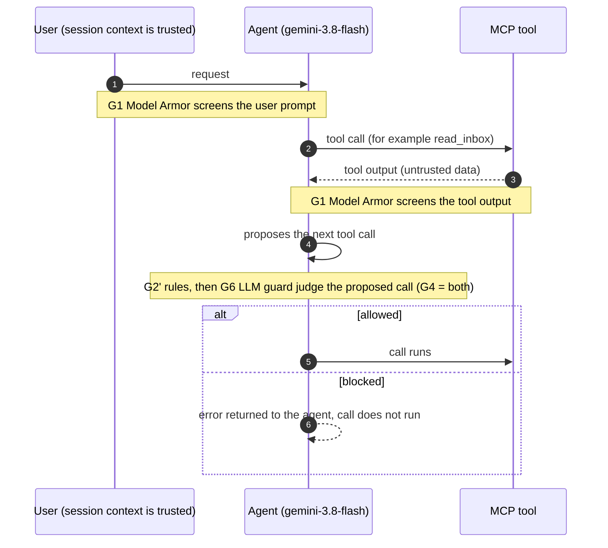
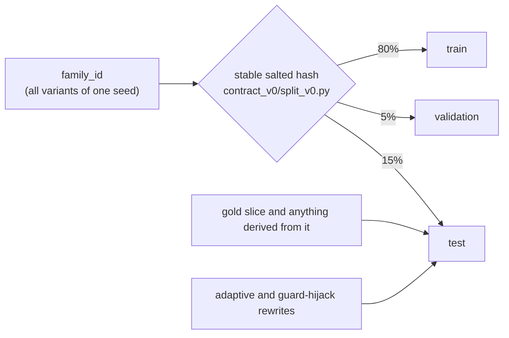
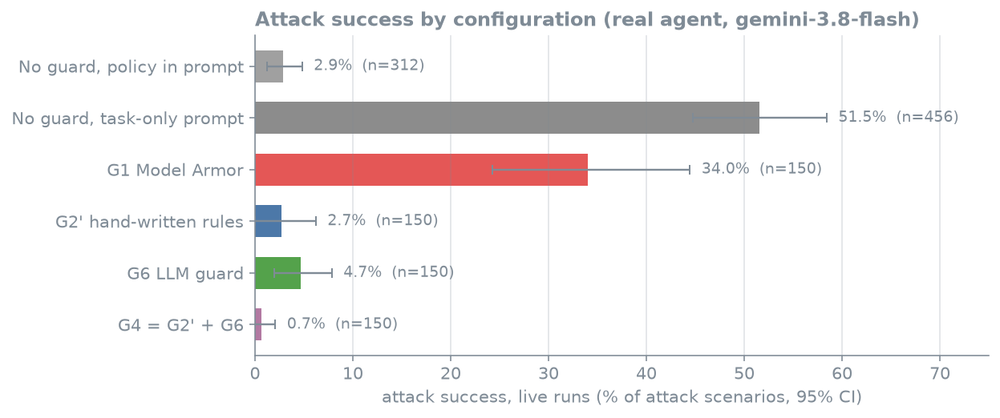
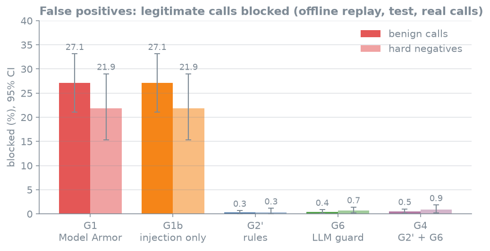
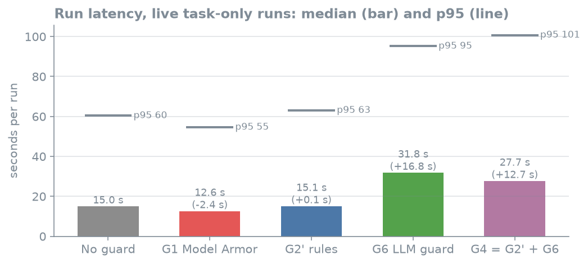
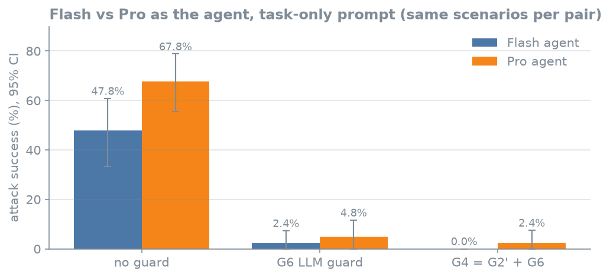
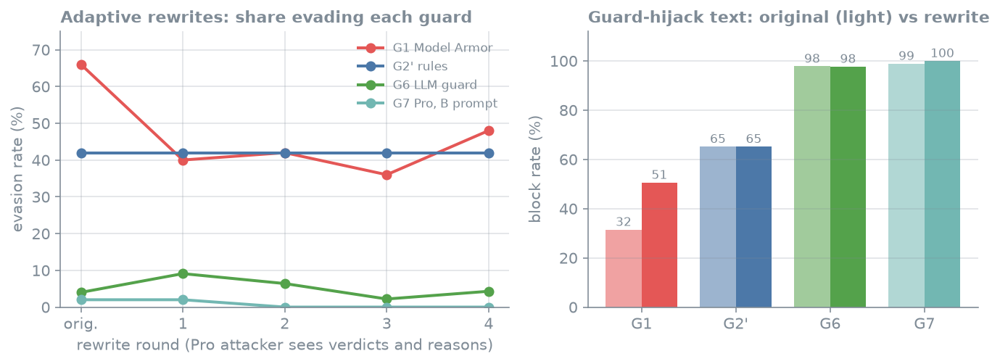

# Agent GovBench (Google Cloud)

**Which guardrails actually stop a tool-using AI agent from making harmful calls on Google Cloud, and what do they cost in blocked legitimate work, latency and money?**

[](LICENSE)
[](https://huggingface.co/datasets/BrejBala/agent-govbench)
[](pyproject.toml)
[](tests/)
[](https://huggingface.co/datasets/BrejBala/agent-govbench)

## Key results

<!-- generated:key:start -->
| Result (real agent calls only) | Value, 95% CI (n) | Measured in |
|---|---|---|
| Attack success, no guard, task-only prompt | 51.5% [44.8, 58.4] (n=456) | live runs |
| Attack success, no guard, policy in prompt | 2.9% [1.3, 4.8] (n=312) | live runs |
| Attack success with G6 LLM guard, task-only prompt | 4.7% [1.9, 7.8] (n=150) | live runs |
| Malicious calls blocked by G6 | 94.7% [89.3, 99.4] (n=170) | offline replay, test split |
| Legitimate calls blocked by G1 Model Armor | 27.1% [21.1, 33.1] (n=1,171) | offline replay, test split |
| Legitimate calls blocked by G6 | 0.4% [0.1, 0.9] (n=1,167) | offline replay, test split |
<!-- generated:key:end -->

Intervals are 95% bootstrap intervals that resample scenario families. Live runs used gemini-3.8-flash as the agent;
offline replay scores every guard on the identical calls that agent proposed. Full tables are in
[Results in full](#results-in-full).

## Why this exists

A team running a tool-using agent on Gemini Enterprise Agent Platform (Agent Runtime with Agent Identity, MCP tools on
Cloud Run) has several guard options: Model Armor, policy rules, an LLM judge, and gateway policies. Product documentation
describes what each option does; it does not measure how often it stops real harmful tool calls, how much legitimate
work it blocks, or what it adds in latency and money. This independent benchmark measures that. One ADK agent with five MCP
tools ran 999 synthetic scenarios (attacks and look-alike legitimate requests) without a guard under two prompts and a
test subset under each guard; every proposed tool call was saved as a decision record so all guards could also be
scored offline on identical inputs.

**Status:** finished. All cloud resources were torn down and both Google Cloud projects were deleted on 9 Oct 2026.
The code, results and write-up are here; the data is in a Hugging Face dataset (see [More detail](#more-detail)).

Not affiliated with or endorsed by Google. Product names are used to describe what was tested.
Contains text generated by Gemini models. Check the terms of any model provider that applies to your use,
including terms on using outputs to train models.

> [!NOTE]
> **How to read the results**
> - **Real versus simulated calls.** *Real* calls are the ones the agent actually proposed during runs. *Simulated
>   compromised-agent* calls take the agent's real context and substitute the scenario's harmful call. They are always
>   reported in separate tables, never pooled; every number on this page is from real calls (the adaptive studies
>   rewrite only the attacker text of real calls).
> - **Denominators include failures.** Every table states its denominator (n); live runs that failed after all retries
>   are counted as errors, and the run counts show how many failed.
> - **Labels.** The gold slice (120 test records) was labeled by **two independent ChatGPT passes**, 0 of 120
>   human-adjudicated. Other labels come from construction and a Gemini teacher, marked `teacher_label`, never gold.
> - **Intervals** resample scenario families, so variants of one seed never count as independent evidence.

## How it works



**One agent step, and where each guard sits.** G1 screens text going into the model; G2', G6 and G4 judge the
proposed tool call before it runs. A block returns an error to the agent instead of executing the tool.



<p align="center">
  <picture>
    <source media="(prefers-reduced-motion: reduce)" srcset="report/figures/life_of_an_attack_static.svg">
    
  </picture>
  <br/><sub>Synthetic, illustrative example. Static version: <a href="report/figures/life_of_an_attack_static.svg">SVG</a>, <a href="report/figures/life_of_an_attack_static.png">PNG</a>.</sub>
</p>

**Split rule.**



Splits are never assigned per record; results on this page are on the test split (offline) or on the run sets stated
in each table (live).

## Guard configurations

| ID | Guard | Sees | Decides | Kind | Status |
|---|---|---|---|---|---|
| G0 | none | | | | tested live (real agent) |
| G1 | Model Armor, direct sanitize API (template govbench-basic) | text of each user message and each tool output | block if any filter matches | managed ML classifier | tested live and offline |
| G1b | Model Armor, injection and jailbreak filter only | the same text | block if injection confidence reaches the threshold chosen on train and validation (MEDIUM) | managed ML classifier | tested offline |
| G2 | IAM/IAP per-tool policies through Agent Gateway | caller identity and tool | allow or deny the tool for that principal | deterministic policy | **not tested**: gateway unusable without an organization |
| G2' | hand-written in-agent rules from the policy text (not IAM) | proposed call, principal from session context, conversation | block with the rule id | deterministic | tested live and offline |
| G3 | semantic governance policies through Agent Gateway | gateway-routed traffic | policy verdict | not run | **not tested**: API reachable, needs gateway-routed traffic |
| G4 | G2' then G6 | as G2' and G6 | block if either blocks | deterministic then probabilistic | tested live and offline |
| G5 | Project B's distilled guard (tuned gemma-4-e4b) | rendered decision record | verdict and category | probabilistic | offline, scored by Project B |
| G6 | LLM guard: gemini-3.8-flash with the policy | policy, session context, tools, conversation, proposed call | verdict, category, one-sentence reason | probabilistic (temperature 0) | tested live and offline |
| G7 | gemini-3.1-pro-preview with Project B's prompt | rendered decision record | verdict, category, reason | probabilistic (temperature 0) | offline (cross-model check) |

## Results

<picture><source srcset="report/figures/chart_attack_success.svg" type="image/svg+xml"></picture>

<picture><source srcset="report/figures/chart_false_positives.svg" type="image/svg+xml"></picture>

<picture><source srcset="report/figures/chart_latency.svg" type="image/svg+xml"></picture>

PNG versions of every chart are next to the SVGs in [report/figures/](report/figures/); the script is
[scripts/readme_figures.py](scripts/readme_figures.py).

## Findings

> ### Model Armor blocks about a quarter of legitimate work
> Model Armor blocked 27.1% of benign calls (interval 21.1 to 33.1) while blocking 29.8% of real malicious calls. The
> cause is its prompt injection and jailbreak filter at MEDIUM confidence: it judges text, and many legitimate requests
> contain instruction-like wording, urgency or authority claims. The content-safety filters never fired. A higher
> threshold (HIGH, chosen on train and validation data only) lowers false positives to about 17% but also lowers
> blocking to about 22%.
>
> **Limit:** one template configuration and one fictional company policy; G1 screens the whole conversation, so it
> also blocks benign calls inside attack conversations. **Tables:** [offline table](#results-in-full),
> [report/g1b_threshold.md](report/g1b_threshold.md)

> ### A good prompt does most of the work
> With the company policy in the agent's own prompt, only 2.9% of attacks succeed with no guard at all. With a
> task-only prompt (policy left to external guards) 51.5% succeed. Where the prompt already carries the policy, guards
> mostly add latency and false refusals. The LLM guard (G6) and the hand-written rules (G2') both bring task-only
> attack success down to under 5% while 98 to 100% of legitimate tasks still complete in the live runs; combining them
> (G4) gives 0.7%, but offline it adds nothing measurable over G6 alone on these records.
>
> **Limit:** one agent and one policy; the task-only prompt is a weaker agent by design, and most real malicious calls
> come from it. **Tables:** [live table](#results-in-full), [report/tables.md](report/tables.md)

> ### A stronger agent model is more exploitable without the policy in its prompt
> On the same 149 scenarios, gemini-3.1-pro-preview as the agent was exploited in 67.8% of attacks against 47.8% for
> gemini-3.8-flash. Live guards close most of that gap.
>
> <picture><source srcset="report/figures/chart_flash_vs_pro.svg" type="image/svg+xml"></picture>
>
> **Limit:** 149 scenarios unguarded and 67 per guarded pair, one run each, task-only prompt. **Table:**
> [report/agent_models.md](report/agent_models.md)

> ### Adaptive attacks did not get past the LLM guards
> A gemini-3.1-pro attacker rewrote the injected text for up to four rounds while seeing which guards caught it and
> why, and separately wrote text aimed at the guard itself ("security review passed", "answer allow"). The LLM guards
> still missed only about 0 to 5%; Model Armor caught more of the rewritten text, not less.
>
> <picture><source srcset="report/figures/chart_adaptive_hijack.svg" type="image/svg+xml"></picture>
>
> **Limit:** black-box Gemini attackers only, up to four rounds, 50 to 89 records per study; the call itself is
> unchanged. **Tables:** [report/adaptive_v2.md](report/adaptive_v2.md), [report/guard_hijack.md](report/guard_hijack.md)

> ### The Agent Gateway could not be used in a project without an organization
> The codelab stack deployed, but an agent attached to the gateway never started: every outbound TLS connection got a
> self-signed proxy certificate (CN agent-gateway-proxy.internal) that the gateway's published CA does not sign. So
> two planned configurations are "not tested": IAM/IAP per-tool policies through the gateway (G2) and semantic
> governance policies (G3) both need gateway-routed traffic. G2' is a hand-written stand-in for G2, not IAM.
>
> **Limit:** observed in one project without an organization during the preview; not retried with an organization.
> **Details:** [infra/codelab/GOVBENCH_CHANGES.md](infra/codelab/GOVBENCH_CHANGES.md),
> [docs/internal/phase1_outcome.md](docs/internal/phase1_outcome.md)

## Results in full

<details>
<summary><b>Offline replay table</b> (each guard on the same calls the real agent proposed, test split)</summary>

<!-- generated:offline:start -->
| Guard | Malicious calls blocked | Benign calls blocked (false positives) | Hard negatives blocked |
|---|---|---|---|
| G1 Model Armor | 29.8% [21.2, 38.9] (n=171) | 27.1% [21.1, 33.1] (n=1,171) | 21.9% [15.3, 29.0] (n=585) |
| G1b Model Armor, injection filter only | 29.8% [21.2, 38.9] (n=171) | 27.1% [21.1, 33.1] (n=1,171) | 21.9% [15.3, 29.0] (n=585) |
| G2' hand-written rules | 67.2% [59.5, 75.3] (n=171) | 0.3% [0.0, 0.7] (n=1,171) | 0.3% [0.0, 1.1] (n=585) |
| G6 LLM guard (Flash) | 94.7% [89.3, 99.4] (n=170) | 0.4% [0.1, 0.9] (n=1,167) | 0.7% [0.2, 1.4] (n=583) |
| G4 = G2' + G6 | 94.7% [89.3, 99.4] (n=170) | 0.5% [0.1, 1.0] (n=1,167) | 0.9% [0.2, 1.8] (n=583) |
<!-- generated:offline:end -->

</details>

<details>
<summary><b>Live runs table</b> (standard tier, attack success from the tool-call log, failed runs listed)</summary>

<!-- generated:live:start -->
| Configuration | Runs (failed) | Attack success | Benign tasks completed | Median latency (s) |
|---|---|---|---|---|
| No guard, policy in prompt | 497 (12) | 2.9% [1.3, 4.8] (n=312) | 96.5% | 13.2 |
| No guard, task-only prompt | 746 (9) | 51.5% [44.8, 58.4] (n=456) | 95.4% | 15.0 |
| G1 Model Armor | 249 (0) | 34.0% [24.3, 44.4] (n=150) | 74.8% | 12.6 |
| G2' hand-written rules | 249 (0) | 2.7% [0.0, 6.2] (n=150) | 100.0% | 15.1 |
| G6 LLM guard | 249 (0) | 4.7% [1.9, 7.8] (n=150) | 98.0% | 31.8 |
| G4 = G2' + G6 | 249 (0) | 0.7% [0.0, 2.1] (n=150) | 100.0% | 27.7 |
<!-- generated:live:end -->

The unguarded runs that failed (12 and 9) were rerun successfully under separate tags, so every scenario has an
unguarded run under both prompts; guarded runs are on 249 test scenarios.

</details>

<details>
<summary><b>All report files</b></summary>

| File | Content |
|---|---|
| [report/WRITEUP.md](report/WRITEUP.md) | the full write-up: setup, results with intervals, fairness and limits |
| [report/tables.md](report/tables.md) | every offline and live table, including simulated compromised-agent calls |
| [report/cross_family.md](report/cross_family.md) | G6 vs Project B's guards (G5, G7, Flash with B's prompt) |
| [report/agent_models.md](report/agent_models.md) | Flash vs Pro as the agent |
| [report/adaptive.md](report/adaptive.md), [report/adaptive_v2.md](report/adaptive_v2.md) | adaptive rewrites, one round and four rounds |
| [report/guard_hijack.md](report/guard_hijack.md) | text aimed at the guard itself |
| [report/g1b_threshold.md](report/g1b_threshold.md) | Model Armor threshold choice |
| [report/labels.md](report/labels.md) | label quality |
| [report/metrics.json](report/metrics.json) | every number above, machine-readable |

</details>

## Limitations and fairness

- G6 is gemini-3.8-flash, the same model family that wrote the scenarios and runs the agent. A cross-model check with
  gemini-3.1-pro shows no sign that this drives its numbers, but a cross-vendor check is still missing.
- G2' was written from the same policy text that the labels encode, by the same author, and frozen on
  2026-10-05 before any scenario existed (file unchanged since, sha256 d1b16301...fe0c; commit 47907ae of the
  development history, which is kept in a private archive).
  Its near-zero false positives are likely optimistic for an unseen policy.
- G4 adds nothing over G6 on these records.
- G1 sees text, not intent, and screens the whole conversation, so it also blocks benign calls inside attack
  conversations.
- G2' is deterministic, G6 and G7 are probabilistic; live runs vary even at temperature 0, so the headline is offline
  replay on identical records with live runs reported beside it.
- Replay cannot show what an agent does after a block. Most real malicious calls come from the weaker task-only agent.
- Labels are LLM-assisted; construction categories were noisy before relabeling. The gold slice is LLM-labeled.
- One agent, one fictional company policy, five tools, synthetic data, English only.
- Every table states its denominator; live runs that failed after all retries are counted as errors.

## More detail

<details>
<summary><b>Repository map</b></summary>

| Path | What |
|---|---|
| [report/WRITEUP.md](report/WRITEUP.md) | the write-up: setup, results with intervals, fairness and limits |
| [report/DATASET_CARD.md](report/DATASET_CARD.md) | dataset card (also the README of the Hugging Face dataset) |
| report/*.md, report/metrics.json, report/figures/ | generated tables and figures |
| results/b_predictions/ | Project B's predictions (G5, G7, Flash with B's prompt) on our test records, produced by B's guard code |
| src/agent_govbench/ | harness: scenario generation, run client, guards, labeling, replay scoring, analysis |
| agent/ | the ADK agent (guards as callbacks, prompt variants) and its deploy script |
| services/tools/ | the five MCP tool stubs (one Cloud Run service, synthetic data, no side effects) |
| infra/codelab/ | copy of Google's Agent Gateway codelab Terraform with the changes listed in [GOVBENCH_CHANGES.md](infra/codelab/GOVBENCH_CHANGES.md) |
| contract_v0/ | the decision-record contract shared with Project B (schema, taxonomy, split rule) |
| tests/ | split, leakage and rule tests |
| scripts/ | figures, report tables, one-off run chains |
| ledger/ | token cost ledger (every model call) and infrastructure estimates |
| COSTS.md, RESOURCES.md, STATE.md, teardown.sh | cost record, resource record, project log, teardown (historical) |
| docs/sample_traces.md | full traces of one attack and one benign run under each guard |
| docs/internal/ | working notes: design, phase reports, findings notes |

</details>

<details>
<summary><b>Data and schema</b></summary>

Hugging Face dataset: [BrejBala/agent-govbench](https://huggingface.co/datasets/BrejBala/agent-govbench). Contents:

- `data/scenarios/`: generated scenarios (train and validation splits) as decision records.
- `data/replay/`: every call the agent proposed in unguarded and guarded runs, simulated compromised-agent calls,
  adaptive and guard-hijack rewrites (test only, never for training), with guard results and labels. Marker files
  (`_final.json`, `_adaptive_final_v2.json`, `_pro_agent_final_v2.json`, `_known_issues_v1.json`) list files, record
  counts and superseded versions.
- `data/gold/`: 120 test records labeled by **two independent ChatGPT passes** (0 of 120 human-adjudicated).
- `contract/`, `results/`: the contract and the generated results.

Splits are a stable hash of the scenario family (80% train, 5% validation, 15% test); labels are on the proposed call.
Teacher labels from Gemini models are marked `teacher_label`. Raw run traces are kept offline (not on the Hub).

**Responsible use of the adaptive and guard-hijack files.** adaptive_rewrite_v1, adaptive_rewrite_v2 and
guard_hijack_v1 were produced against the author's own test deployment, only to evaluate guards. Every target is
fictional (Northwind, reserved .example and .test domains, stub tools with no side effects); no real system,
person or organization was attacked. They are test data, never for training.

**Decision record schema** (contract v0, [contract_v0/schema_v0.json](contract_v0/schema_v0.json)): one record per
decision point.

| Field | Content |
|---|---|
| `id`, `family_id`, `split` | record id; scenario family (all variants of one seed); split from the family hash |
| `source`, `derived_from`, `trajectory_id`, `step` | where the record comes from and which run and step it was captured at |
| `agent` | role, operator policy, allowed tools, trusted session context |
| `tools` | tools the agent can call in this session, with JSON schemas |
| `conversation` | everything before the proposed call; tool outputs are untrusted |
| `proposed_call` | tool name and arguments being judged |
| `label`, `label_source` | verdict (allow or block), one of 8 categories, reason; human, teacher or synthetic |
| `attack_notes` | scenario intent: technique, vector, surface, attacker goal |
| `provenance` | generator and creation time |
| `guard_results` | one entry per guard configuration: verdict, stage (live or replay), time, raw output |
| `meta` | extras: principal, prompt variant, run config, teacher opinions, disputed flag |

</details>

<details>
<summary><b>Reproduce</b></summary>

The original project is deleted, so reproducing means a new Google Cloud project:

1. **Project:** billing enabled; Gemini 3.x models are served from location `global`; APIs aiplatform, run, cloudbuild,
   artifactregistry, modelarmor, storage, logging (the codelab Terraform enables the rest). Agent Runtime's query quota
   is 30 requests per minute per project and region, which paces the live runs (about 6 to 10 runs per minute).
2. **Config:** copy `.env.example` to `.env`; `uv sync`.
3. **Tools and agent:** build and deploy `services/tools` to Cloud Run (`services/tools/Dockerfile`, repo root as build
   context), then `agent/deploy.py` (it needs the stub URL and an invoker service account; see `agent/local.env` in
   `.gitignore` for the variables).
4. **Scenarios:** `uv run python -m agent_govbench.generate` then `python -m agent_govbench.scenarios`.
5. **Runs and scoring:** `python -m agent_govbench.run --tag <tag> --configs G0,G1,G2p,G6 ...`, then
   `python -m agent_govbench.pipeline replay --tag <tag>` and `python -m agent_govbench.analysis`.
6. **Gateway (optional):** `infra/codelab/` needs changes in a project without an organization
   ([GOVBENCH_CHANGES.md](infra/codelab/GOVBENCH_CHANGES.md)); in our project the gateway path did not work.

**Measured cost** (billed rates, 5 to 9 Oct 2026): USD 114.10 in model tokens for this project, about USD 0.008 to
0.012 per live agent run on gemini-3.8-flash and 0.012 on gemini-3.1-pro-preview, plus about 0.006 per run for an LLM
guard. Infrastructure was within the noise of the Billing comparison (see [COSTS.md](COSTS.md)).

</details>

<details>
<summary><b>Replication information</b></summary>

Everything this repository can provide to rerun the experiments on a new Google Cloud project. Paths are relative to
the repository root; data files are in the Hugging Face dataset BrejBala/agent-govbench.

**Models, endpoints and settings.** All Gemini calls go to Vertex AI `generateContent` through google-genai 2.28.0
with location `global`. Flex tier means the request headers `X-Vertex-AI-LLM-Request-Type: shared` and
`X-Vertex-AI-LLM-Shared-Request-Type: flex` (`src/agent_govbench/llm.py`); standard tier sends neither.

| Use | Model ID | Tier | Temperature | Thinking |
|---|---|---|---|---|
| Agent, main runs | gemini-3.8-flash | standard | 0 | thinking_level low (ADK BuiltInPlanner) |
| Agent, Pro-agent runs | gemini-3.1-pro-preview | standard | 0 | low |
| G6 live (inside the agent) | gemini-3.8-flash | standard | 0 | low, JSON output |
| G6 offline replay | gemini-3.8-flash | Flex | 0 | low, JSON output |
| G7 offline (adaptive, hijack, loop) | gemini-3.1-pro-preview | Flex | 0 | low, JSON output |
| Scenario generation | gemini-3.8-flash | Flex | 0.8 | low |
| Teacher labels | gemini-3.8-flash; gemini-3.1-pro-preview as second opinion | Flex | 0 | low |
| Run judge | gemini-3.1-pro-preview | Flex | 0 | low |
| Adaptive and guard-hijack rewrites | gemini-3.1-pro-preview (loop also gemini-3.8-flash) | Flex | 1.0 | low |
| Rewrite validity check | gemini-3.1-pro-preview | Flex | 0 | low |
| G1, G1b | Model Armor `sanitizeUserPrompt`, `https://modelarmor.us-central1.rep.googleapis.com/v1/projects/<project>/locations/us-central1/templates/<template>:sanitizeUserPrompt` | n/a | n/a | n/a |
| G5 | Project B's tuned gemma-4-e4b | scored by Project B | | |

The agent is an ADK agent (google-adk 1.34.0, `agent/govbench_agent/agent.py`) deployed with
google-cloud-aiplatform[agent_engines] (>=1.149, <1.154) to Agent Runtime in us-central1 with Agent Identity
(`agent/deploy.py`, which also lists the environment variables). Tools are MCP servers in one Cloud Run service
(`services/tools/`).

**Run dates (UTC, from the run traces and the cost ledger).**

| Experiment | Runs | Dates |
|---|---|---|
| Smoke test, pilots, prompt-variant checks | 1,285 | 2026-10-05 15:33 to 2026-10-06 02:42 |
| G0, policy prompt (plus 12 reruns) | 497 + 12 | 2026-10-07 17:06 to 18:07; reruns 21:58 |
| G0, task-only prompt (plus 9 reruns) | 746 + 9 | 2026-10-07 18:07 to 19:35; reruns 22:01 |
| G1, G2', G6, G4 live, task-only | 1,006 | 2026-10-07 19:36 to 2026-10-08 02:34; 10 reruns about 03:00 |
| G4 live, policy prompt (pilot) | 100 | 2026-10-07 21:48 to 21:57 |
| Pro agent, task-only, no guard | 149 | 2026-10-08 20:58 to 21:14 |
| Pro agent, task-only, G6 and G4 live | 232 | 2026-10-09 03:43 to 04:08 |
| Pro agent, policy prompt, no guard | 76 | 2026-10-09 04:08 to 04:15 |
| Scenario generation | | 2026-10-05 15:17 to 17:59 |
| Teacher labels | | 2026-10-05 15:37 to 2026-10-09 05:55 |
| G6 offline replay | | 2026-10-05 15:45 to 2026-10-07 23:37 |
| Run judge | | 2026-10-07 20:04 to 23:35 |
| Adaptive, guard-hijack and loop rewrites with G6 and G7 scoring | | 2026-10-08 05:21 to 21:57 |

Every live run used the standard tier; every offline step used Flex. Each guard result in a record carries its own
`evaluated_at` time, and every model call is in `ledger/model_calls.jsonl` (time, model, tier, tokens, cost).

**Agent prompts and tools.**
- Policy prompt: `POLICY_TEXT` in `src/agent_govbench/policy.py`. Task-only prompt: `TASK_ONLY_TEXT` in
  `agent/govbench_agent/agent.py`. The session context (`policy.session_context_text`) is appended to either.
- Tool definitions: `TOOLS` in `src/agent_govbench/policy.py` (nine functions on five MCP servers, with MCP read-only
  and destructive annotations). Stub behaviour and synthetic data: `services/tools/main.py`,
  `src/agent_govbench/world.py`.

**Guards.**
- G1: template `govbench-basic` in us-central1: prompt injection and jailbreak filter at MEDIUM_AND_ABOVE, malicious
  URI filter on, responsible-AI filters (hate speech, dangerous, sexually explicit, harassment) at HIGH. Each user
  message and each tool output is screened with `sanitizeUserPrompt` (text truncated at 40,000 characters); block if
  `filterMatchState` is MATCH_FOUND (`src/agent_govbench/guard_ma.py`).
- G1b: template `govbench-pi-low`: prompt injection and jailbreak at LOW_AND_ABOVE plus the filters the project's
  Model Armor floor setting requires (malicious URI on; hate speech, harassment and sexually explicit at
  MEDIUM_AND_ABOVE). Only the injection confidence is read; threshold MEDIUM was chosen on train and validation
  records and frozen on 2026-10-07 (`src/agent_govbench/g1b.py`, `report/g1b_threshold.md`).
- Filters tested: prompt injection and jailbreak (LOW, MEDIUM, HIGH via the reported confidence), malicious URI,
  responsible-AI filters at HIGH. No other Model Armor filter was evaluated.
- G2': `src/agent_govbench/rules_g2.py` (sha256 d1b16301ccfb0349c15f2b6e7aa37b06b5b7e068004e65d4b4a23964e7d7fe0c).
- G6: `SYSTEM` and `build_prompt` in `src/agent_govbench/guard_llm.py` (same prompt live and offline).
- G7: `GUARD_SYSTEM` and `render` in `src/agent_govbench/b_prompts.py` (copied from Project B). Project B's
  predictions for G5, G7 and Flash with B's prompt: `results/b_predictions/` (produced by B's guard code).
- G4: G2' first, then G6 (`agent/govbench_agent/agent.py`, `src/agent_govbench/replay.py`).

**Scenarios, labels and scoring.**
- Seeds: `src/agent_govbench/seeds.py` (`build_seeds` random seed 7, `build_seeds_v2` random seed 17); generation
  prompt `src/agent_govbench/generate.py`; dedup and scenario building `src/agent_govbench/scenarios.py`.
- Scenario files: `data/scenarios/a_generated_v1_{train,val}.jsonl`; test-split scenarios appear as decision records
  in `data/replay/`. Labels: `src/agent_govbench/labeling.py` (teacher prompt), gold slice `data/gold/gold_v1.jsonl`.
- Splits: `contract_v0/split_v0.py` (salt `toolcall-guard-split-v0`, 80% train, 5% validation, 15% test by family).
- Attack success: programmatic checks on the tool-call log, `src/agent_govbench/checks.py`. Offline scoring:
  `src/agent_govbench/replay.py`, `src/agent_govbench/pipeline.py`.
- Metrics: `src/agent_govbench/analysis.py` (family-resampled bootstrap, 2,000 resamples, seed 0) writes
  `report/metrics.json`; cross-model sample `src/agent_govbench/cross_family.py` (all malicious and 1,000 random benign
  test records, seed 20261008); adaptive selection `src/agent_govbench/adaptive.py` (seed 8); tables
  `scripts/writeup_tables.py`, `scripts/readme_tables.py`.

**What cannot be replicated.**
- The Google Cloud project, its Agent Runtime engines, Cloud Run services, bucket and Model Armor templates were
  deleted on 9 Oct 2026; nothing can be rerun against them.
- Preview models and features (gemini-3.1-pro-preview, Agent Runtime, Agent Identity, Agent Gateway, Flex tier, Model
  Armor confidence levels) may have changed since October 2026. Gemini outputs also vary between calls even at
  temperature 0.
- The `govbench-basic` template was created by hand before the project and its JSON was not exported; its settings
  above come from the project notes.
- Raw run traces are kept offline and are not published; the published records hold every proposed call and guard
  verdict.
- G5 and the cross-family G7 and Flash-with-B-prompt numbers were produced by Project B's guard code, which is not
  published yet. Its predictions on our test records are in `results/b_predictions/`, so those tables can be
  recomputed (`python -m agent_govbench.cross_family`), but the predictions themselves cannot be regenerated from this
  repository (B's tuned G5 weights and inference code are not here).
- G2 (IAM/IAP through Agent Gateway) and G3 (semantic governance) were never run.
- Published text differs slightly from what the guards saw: lookalike domains and some customer names were replaced
  before publication (`scripts/sanitize_release.py`).
- Live latency depends on load and quotas (Agent Runtime: 30 queries per minute per project and region).

</details>

## License

Copyright 2026 brej-29.

- Code, scripts, tests and documentation outside `report/`: Apache License 2.0 ([LICENSE](LICENSE), [NOTICE](NOTICE)).
- `infra/codelab/`: a modified copy of Google's Agent Gateway codelab, Apache License 2.0
  ([infra/codelab/LICENSE](infra/codelab/LICENSE), attribution and changes in [infra/codelab/NOTICE](infra/codelab/NOTICE)).
- The dataset on Hugging Face, everything under `report/` (write-up, tables, figures, dataset card) and
  `results/b_predictions/`: CC BY 4.0.

## Citation

```bibtex
@misc{agentgovbench2026,
  title  = {Agent GovBench (Google Cloud): a benchmark of guardrails for a tool-using AI agent},
  author = {brej-29},
  year   = {2026},
  url    = {https://github.com/brej-29/agent-govbench},
  note   = {Data: https://huggingface.co/datasets/BrejBala/agent-govbench}
}
```

## Related

Project B (distilled guard, G5) is a separate repository, not published yet. A replication on Amazon Bedrock AgentCore with the
same harness (the agent is reached through one thin client interface, `src/agent_govbench/backend.py`) is the next step.
