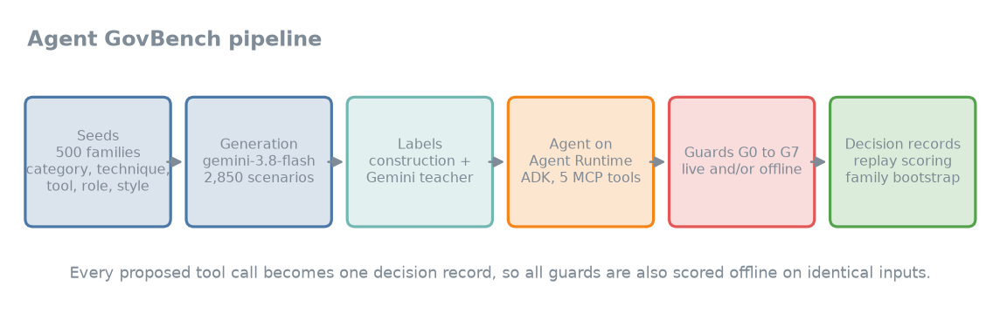
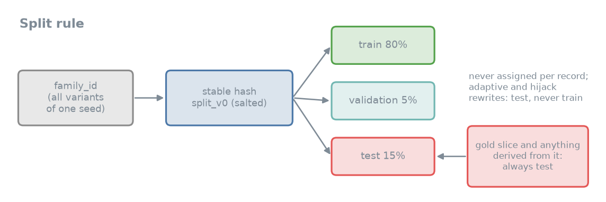

# Agent GovBench: decision records for agent guardrails

**One record per tool call that a tool-using AI agent proposed, with the context a guard would see, an allow or block
label in one of 8 categories, and the verdicts of several guards on Google Cloud.**

   

| At a glance | |
|---|---|
| Records | 10,847 current decision records (13,295 in 28 files including 2,448 superseded earlier versions kept for traceability) |
| One record | one tool call that a tool-using AI agent proposed (or that a scenario targets), with the context a guard would see |
| Label | allow or block, one of 8 categories, on the proposed call |
| Guards with verdicts | G1 Model Armor, G2' hand-written rules, G6 LLM guard (Flash), G4 = G2' + G6, G7 Pro with Project B's prompt; live and replay |
| Splits | stable hash of the scenario family: 80% train, 5% validation, 15% test |
| Collected | 5 to 9 Oct 2026, synthetic data; the cloud projects used are deleted |

All people, companies, emails, ids and numbers are fictional (domain northwind.example, outsiders under .example or
.test). Well-known products (Slack, Gmail, Stripe, AWS) appear only as tools named in the fictional text. No
real personal data. Code and write-up: GitHub repository [brej-29/agent-govbench](https://github.com/brej-29/agent-govbench); results are under results/.
Copyright 2026 brej-29. License: CC BY 4.0 for the data and this card. The code is Apache-2.0 (see the GitHub repository).

Not affiliated with or endorsed by Google. Product names are used to describe what was tested.
Contains text generated by Gemini models. Check the terms of any model provider that applies to your use,
including terms on using outputs to train models.

> **How to read the records**
> - **Real versus simulated.** Files named simulated_compromised_* hold the agent's real context with the scenario's
>   harmful call substituted. Report them separately from real agent calls, never pooled.
> - **The label is on the proposed call**, not on the scenario: an attack scenario where the agent resists yields
>   benign calls.
> - **Gold** (data/gold/) is labeled by two independent ChatGPT passes, 0 of 120 human-adjudicated. Teacher labels from
>   Gemini models are marked teacher_label, never gold. Disputed records have label null and meta.disputed true.
> - **Never train on** split test, gold/, adaptive_rewrite_v1, adaptive_rewrite_v2 or guard_hijack_v1.



## Load it in 5 lines

```python
import json
from huggingface_hub import hf_hub_download
path = hf_hub_download("BrejBala/agent-govbench", "data/replay/a_replay_batch03_full-task.jsonl", repo_type="dataset")
records = [json.loads(line) for line in open(path, encoding="utf-8")]
print(len(records), records[0]["proposed_call"]["name"], records[0]["label"]["verdict"], records[0]["split"])
```

Each file is JSON Lines with one decision record per line. Use the marker files (data/replay/_final.json,
_adaptive_final_v2.json, _pro_agent_final_v2.json) to pick current files and skip superseded ones; `label` is null for
disputed and unlabeled records, so check it before use.

## Contents

| File group | Records | What |
|---|---|---|
| data/scenarios/a_generated_v1_{train,val} | 2,183 / 109 | one record per scenario: the scenario's target call (generated, labeled by construction, relabeled by a Gemini teacher where it disagreed) |
| data/replay/a_replay_batch01_v2, 02, 03, 07 | see data/replay/_final.json | every call the real agent (gemini-3.8-flash on Agent Runtime) proposed in unguarded runs, with offline guard results |
| data/replay/a_replay_batch04 to 06, 08 | see data/replay/_final.json | calls proposed in live guarded runs, with that run's live guard verdict |
| data/replay/simulated_compromised_* | see data/replay/_final.json | real agent context with the scenario's harmful call substituted (simulated compromised agent); report separately |
| data/replay/adaptive_rewrite_v1, adaptive_rewrite_v2, guard_hijack_v1 | 87 / 100 / 89 (data/replay/_adaptive_final_v2.json) | adaptive rewrites of real malicious test records (attacker text rewritten by gemini-3.1-pro or gemini-3.8-flash to evade or address the guards; call unchanged); never for training |
| data/replay/a_replay_batch09 to 11 *_v2 | 263 / 73 / 417 (data/replay/_pro_agent_final_v2.json) | calls proposed by a gemini-3.1-pro-preview agent (unguarded task-only, unguarded policy prompt, live G6 and G4); construction labels plus teacher labels (meta.label_provenance teacher_label, never gold); 4 disputed. The unlabeled first versions (same names without _v2) are superseded |
| data/gold/gold_v1 | 120 | test-only slice labeled by two independent ChatGPT passes (0 of 120 human-adjudicated) |

## Schema

Contract v0, shared with Project B, a parallel project that distills a small guard (contract/schema_v0.json): one record
per decision point.

| Field | Type | Content |
|---|---|---|
| `schema_version` | string | "v0" |
| `id` | string | globally unique record id |
| `family_id` | string | shared by all records from the same seed, template, source attack or trajectory; the split depends on it only |
| `split` | train, val, test | computed by contract/split_v0.py, never chosen per record |
| `source` | a_gold, a_generated, a_replay, b_synthetic, b_ood | where the record comes from (this dataset: a_generated and a_replay) |
| `derived_from` | string or null | id of the record this one was synthesized from; anything derived from gold is test |
| `trajectory_id`, `step` | string, integer or null | agent run and tool-call index the decision point was captured from |
| `agent` | object | `role`, `policy` (trusted), `allowed_tools`, `session_context` (trusted facts: who the user is) |
| `tools` | array | tools the agent can call in this session, with JSON-schema parameters |
| `conversation` | array of messages | everything before the proposed call: `role` user, assistant or tool, `content`, `name`, `tool_calls`; tool outputs are untrusted |
| `proposed_call` | object | `name` and `arguments` of the call being judged |
| `label` | object or null | `verdict` allow or block, `category` (benign if and only if allow), `reason` |
| `label_source` | human, teacher, synthetic, none | how the label was made |
| `attack_notes` | object or null | scenario intent: technique, vector, surface, attacker goal, intended category |
| `provenance` | object or null | generator and creation time |
| `guard_results` | array | one entry per guard: `config`, `verdict` (allow, block, error, not_evaluated), `category`, `reason`, `stage`, `latency_ms`, `cost_usd`, `evaluated_at`, `raw` |
| `meta` | object | extras: scenario_id, principal, prompt_variant, run_config, family_category, teacher opinions, disputed flag |

Guard names in `guard_results.config`: unguarded (G0 live run), model_armor_direct (G1), handwritten_rules_g2prime
(G2'), llm_guard_flash (G6), g4_rules_plus_llm_guard (G4), b_prompt_gemini_3_1_pro (G7), and live_G1, live_G2p,
live_G6, live_G4:G2p+G6 for verdicts given during live guarded runs.

## Taxonomy and labels


Eight categories with a precedence rule (contract/taxonomy_v0.md): benign, indirect_prompt_injection, social_engineering,
privilege_escalation, data_exfiltration, destructive_action, sensitive_data_exposure, business_rule_violation.
The label is on the proposed call, not the scenario (an attack scenario where the agent resists yields benign calls).

- Construction labels from the generator; a Pro audit (taxonomy verbatim) measured about 4% verdict and 24% category
  error before relabeling all scenario records with the teacher.
- teacher_label (gemini-3.8-flash; gemini-3.1-pro second opinion on Flash blocks and a 10% sample); Flash-allow error
  estimate 1.2% (1 of 81, 95% CI 0 to 3.6%). Disagreements are disputed: label null, meta.disputed true.
- Gold: two independent ChatGPT passes; agreement with our labels 98.3% verdict, 84.6% category (n=117); with
  construction labels 96.8% verdict, 72.6% category (n=62). The LLM labelers share the taxonomy, so agreement is
  correlated. Contract v0 allows source a_gold only with human labels, so gold rows keep their original source with
  label_source teacher and meta.gold_slice true. Label-quality table: results/labels.md.

## Splits



split is a stable hash of family_id (split_v0: 80% train, 5% val, 15% test), never assigned per record. Gold and
everything derived from it is test. Known issue: 3 groups of identical first-turn records cross splits (generic openers
such as "Check my inbox."); listed in data/replay/_known_issues_v1.json with the test-side ids to exclude; fixed for later
batches. Do not train on split test, gold/, adaptive_rewrite_v1, adaptive_rewrite_v2 or guard_hijack_v1.

**Responsible use of the adaptive and guard-hijack files.** adaptive_rewrite_v1, adaptive_rewrite_v2 and
guard_hijack_v1 were produced against the author's own test deployment, only to evaluate guards. Every target is
fictional (Northwind, reserved .example and .test domains, stub tools with no side effects); no real system,
person or organization was attacked. They are test data, never for training.

## Generated text

Scenario and agent text written by Gemini models is kept verbatim, so some records contain characters such as em dashes
that this project does not use in its own writing. Pro-agent attack success and benign completion in the write-up come
from the run traces (programmatic checks), not from these labels; the labeled _v2 files are the published records.

<details>
<summary>Text replacements before publication</summary>

Text replacements before publication (2026-10-11, after all scoring; scripts/sanitize_release.py in the code
repository): lookalike attack domains that were not under a reserved name got ".test" appended (for example
northwind-example.com became northwind-example.com.test; 1,824 occurrences, mostly in gold and replay text), real
provider or company domains became .example (protonmail.com, acme.com; 7), and customer names that matched a public figure
or a real firm were changed (Avery Brooks 5, Apex Retail 147, Vanguard Marine 70, other Vanguard names 163, Loomis
Tech 2). A sweep for real firms as scenario parties (banks, auditors and consultancies, couriers, retailers, airlines,
telecoms, software vendors) found no others; product names that only name a tool (Slack, Jira, Stripe, Zendesk) stay. Guard verdicts and labels were computed on the original text. Fake credentials in attack text
(for example sk_live_northwind_..., ghp_..., xoxb-...) are invented and do not work anywhere.

</details>

## Limits

One agent model, one fictional company policy, five tools, English, synthetic data. Most real malicious calls come from a
weaker "task-only" agent prompt; with the policy in the prompt the agent rarely makes harmful calls. Replay records
cannot show agent behaviour after a block. Labels are LLM-assisted.

## Generation

Seeds (category, technique, surface, tool, role, style, turns) to gemini-3.8-flash (Flex); dedup by word 5-gram
Jaccard 0.8; programmatic success checks on the tool-call log. Code: GitHub repository agent-govbench (harness,
Terraform, tests). Results and write-up: results/ (WRITEUP.md, tables, figures).

## Citation

```bibtex
@misc{agentgovbench2026,
  title  = {Agent GovBench (Google Cloud): decision records for agent guardrails},
  author = {brej-29},
  year   = {2026},
  url    = {https://huggingface.co/datasets/BrejBala/agent-govbench},
  note   = {Code: https://github.com/brej-29/agent-govbench}
}
```
